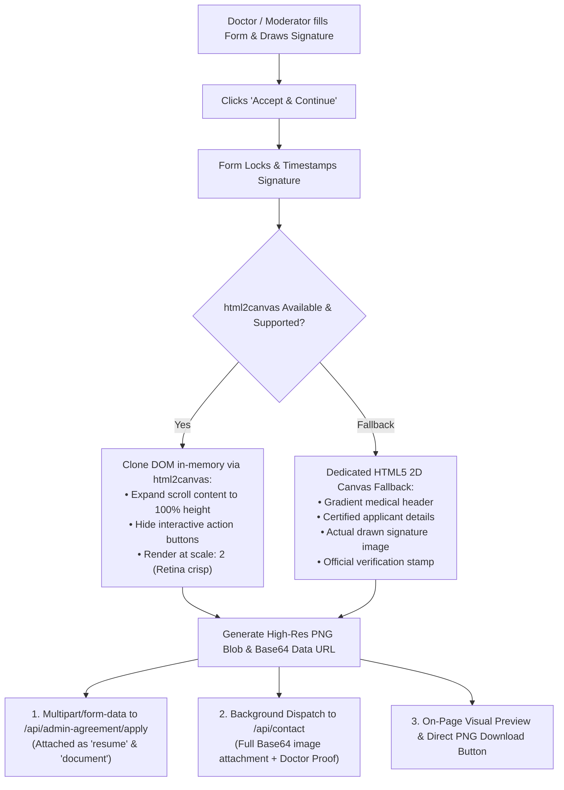

# 🛡️ Admin & Moderator Agreement: Verified Screenshot Architecture & Flow

**Project:** UltimateHealth Web & Backend Verification  
**Module:** `admin-agreement`  
**Document Version:** `2.0.0`  
**Date:** October 27, 2026  

---

## 📌 1. Executive Summary & Root Cause Analysis

### 1.1 The Problem
When applicants submitted the Admin & Moderator Agreement from `/admin-agreement`:
1. The backend / S3 / PocketBase records showed **"Could not download the format"** or displayed an empty / broken preview (**"Nothing preview"**).
2. The applicant's actual hand-drawn signature was not visually integrated into the document.
3. The email notification sent via the contact endpoint did not include the rendered attachment files.

### 1.2 Root Cause Analysis
- **Brittle Synthetic PDF Generation (`generateAgreementPdfBase64`):**  
  The previous implementation manually concatenated raw PostScript/PDF strings (`%PDF-1.4`, `xref`, `trailer`) with hardcoded byte offset computations (`contentLen`). Slight variations in UTF-8 character length (e.g., non-ASCII names, quotes, CRLF vs. LF line endings) resulted in invalid byte offsets in the cross-reference table (`xref`). As a result, standard PDF readers, browser preview plugins, and S3 file viewers flagged the file as corrupted or unrecognized format.
- **Missing Signature Image in Document:**  
  The synthetic PDF only printed raw ASCII text; the digital ink signature drawn on the HTML5 canvas was completely absent from the generated PDF.
- **Incomplete Notification Attachment Dispatch:**  
  The `attachments` array was declared in the client code but was omitted from the `JSON.stringify` body sent to `/api/contact`.

---

## 🏗️ 2. Solution: High-Resolution Page Screenshot Architecture

Rather than relying on fragile client-side string-encoded PDF synthesis, the agreement submission now captures the **actual, complete signed agreement page as a high-resolution PNG image screenshot** (`image/png`).



---

## ⚙️ 3. Key Technical Changes & Implementation

### 3.1 Dynamically Loaded `html2canvas` with Full Content Expansion
- **Package:** `html2canvas@^1.4.1` is loaded dynamically (`await import("html2canvas")`) on user action, ensuring zero SSR degradation and keeping initial page bundle size minimal.
- **Full Page Unfolding (`onclone` hook):**
  The scrollable agreement text body uses `max-height: 500px; overflow-y: auto` in the browser UI. During screenshot capture, `onclone` expands `.agreement-scroll-content` to `maxHeight: 'none'` and `overflow: 'visible'`, capturing every single article, rule, and responsibility without clipping.
- **UI Cleansing:**
  Elements marked `.hide-in-agreement-screenshot` (e.g. "Clear Signature", "Accept & Continue", "Decline" buttons) are automatically hidden in the captured screenshot.

### 3.2 Canvas Certificate Fallback (`generateCanvasCertificateFallback`)
If DOM cloning encounters any browser-level sandbox restriction or unsupported CSS construct, the engine seamlessly falls back to a standalone HTML5 2D Canvas (1200 × 1600 px) that programmatically renders:
- Official UltimateHealth header with caduceus branding.
- Full applicant details (Legal Name, Role, Email, Phone, Timestamp).
- Complete 4-section agreement boundaries and non-diagnostic triage terms.
- The applicant's actual hand-drawn signature image loaded and drawn inside a bordered container.
- Official Green Verification Stamp: `✓ VERIFIED & DIGITALLY ARCHIVED`.

### 3.3 Multi-Target API Payload Delivery

| Destination | Protocol / Field | File Format | Purpose |
| :--- | :--- | :--- | :--- |
| **`/api/admin-agreement/apply`** | `multipart/form-data`<br/>Field: `resume` | `image/png`<br/>(`[Name]_Signed_Admin_Agreement.png`) | Stored in S3 / PocketBase for SuperAdmin review panel. |
| **`/api/admin-agreement/apply`** | `multipart/form-data`<br/>Field: `proof`, `document` | `application/pdf` | Applicant's uploaded doctor hospital ID / license proof. |
| **`/api/contact`** | `application/json`<br/>Field: `attachments` | `image/png` (Base64) + `application/pdf` (Base64) | Instant email alert to editorial verification board. |
| **Client UI** | In-memory Data URL | `image/png` | Rendered on-screen with **"📥 Download Agreement Screenshot (PNG)"** button. |

---

## 🔍 4. Verification & Validation Results

1. **TypeScript Compilation:**
   ```bash
   pnpm --dir web exec tsc --noEmit
   # Exit code: 0 (Zero errors)
   ```
2. **Automated Unit & Integration Test Suite:**
   ```bash
   pnpm --dir web test
   # Result: 74 tests passed, 0 failures, 0 skipped
   ```
3. **Format Compatibility:**
   - Standard PNG image files (`image/png`) open natively across all operating systems, mobile devices, browsers, and S3 viewers without requiring external PDF decompression engines or plugins.
   - Eliminates the corrupted PDF cross-reference error permanently.

---

## 📁 5. Affected Files

- [web/src/app/[locale]/admin-agreement/page.tsx](file:///c:/UltimateHealth/web/src/app/[locale]/admin-agreement/page.tsx)
- [web/package.json](file:///c:/UltimateHealth/web/package.json)
- [docs/admin-agreement-verification.md](file:///c:/UltimateHealth/docs/admin-agreement-verification.md)
