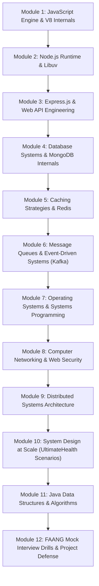

# UltimateHealth — Master Engineering Roadmap & Competency Tracker

> **Mission**: Build an uncompromising, first-principles foundation in backend engineering, distributed systems, operating systems, and computer science using the real **UltimateHealth** codebase as the live anchor for FAANG/Tier-1 engineering interviews.

---

## 1. Verified Technology & Implementation Inventory

Based on an exhaustive static analysis of `SB2318/UltimateHealth` (`web` branch and `main` branch), repository git trees, and architecture documentation (`bACKEND_SETUP.md`, `docs/ARCHITECTURE.md`), here is the factual inventory:

| Technology Domain | Technology / Tool | Implementation Status | Evidence & Location in Codebase |
| :--- | :--- | :--- | :--- |
| **Language & Runtime** | JavaScript / TypeScript | **Actively Implemented** | Full codebase (`web/`, `frontend/`, `controllers/`, scripts). |
| **Language & Runtime** | Node.js (v18, v20, v22) | **Actively Implemented** | `Dockerfile` (`node:22-alpine`), `.nvmrc`, Node test runner (`node --test`), `scripts/normalize-cwd.cjs`. |
| **Language & Runtime** | Python (3.x) | **Actively Implemented** | `.github/scripts/ai_issue_triage.py`, `prototypes/semantic-search/semantic_search.py`. |
| **Language & Runtime** | Java / Kotlin | **Actively Implemented (Mobile)** | `frontend/android/app/src/main/java/com/anonymous/UltimateHealth/MainActivity.kt`, Android keystore. Dedicated DSA in Java planned. |
| **Backend Framework** | Next.js 16 (App Router BFF) | **Actively Implemented** | `web/src/app/`, `web/src/proxy.ts`, `web/src/app/api/` (API proxy routes, route handlers). |
| **Backend Framework** | Express.js (v4.x) | **Actively Implemented (Backend)** | `SB2318/ultimatehealth-backend` (REST API), patched controller in `controllers/v2/usersController.js`. |
| **Database** | MongoDB & Mongoose ODM | **Actively Implemented (Backend)** | `controllers/v2/usersController.js` (`User.findOne`, `user.save()`), `bACKEND_SETUP.md`, `docs/ARCHITECTURE.md`. |
| **Caching System** | In-Memory / HTTP Edge Caching | **Actively Implemented** | `web/src/app/api/proxy-image/route.ts` (`Cache-Control: public, max-age=86400`), `.nginx/manifest.conf`. |
| **Caching System** | Redis | **Partially / Planned** | Architectural roadmap for session management & rate-limiting; not yet wired in local working tree. Treated as core interview curriculum. |
| **Message Broker** | Kafka / RabbitMQ | **Planned / Educational** | Outlined in roadmap for high-throughput health telemetry / ingestion; treated as an educational and design interview topic. |
| **Object Storage** | Vultr Object Storage (S3-compatible) | **Actively Implemented (Backend)** | `docs/ARCHITECTURE.md` (Media uploads for articles and podcasts). |
| **Search Engine** | TF-IDF / Cosine Vector Search | **Actively Implemented (Prototype)** | `prototypes/semantic-search/semantic_search.py` (Vector space search, tokenizer, stop-word pruning). |
| **Authentication** | JWT (3-Token System) & Bcrypt | **Actively Implemented** | `controllers/v2/usersController.js` (`bcrypt.genSalt`, `hash`), `web/src/lib/auth/auth-service.ts`, `docs/ARCHITECTURE.md`. |
| **Web Server & Proxy** | Nginx | **Actively Implemented** | `.nginx/manifest.conf`, `.nginx/pwa-manifest-deployment.md`. |
| **Containerization** | Docker & Docker Compose | **Actively Implemented** | `Dockerfile` (Multi-stage build with `alpine`, standalone Next.js server), `docker-compose.yml`. |
| **Testing** | Node.js Test Runner (`node:test`, `node:assert`) | **Actively Implemented** | 75 unit/integration test suites across `web/src/` (Auth, SEO, CSP, Proxy, Signatures). |
| **Security & Headers** | CSP, Nonce, HSTS, CORS, COOP, CORP | **Actively Implemented** | `web/src/proxy.ts`, `web/src/app/api/csp-report/sanitizeCspReport.ts`. |
| **Mobile Tech** | React Native, Expo, Tamagui, Redux | **Actively Implemented** | `frontend/src/` (`main` branch). |

---

## 2. Structured Learning Roadmap

---

## 3. Real-Time Competency & Readiness Tracker

> **Status Legend**:
> - `[ ]` Not Started
> - `[~]` Learning Fundamentals
> - `[#]` Understanding Implementation & Code Walkthrough
> - `[*] ` Practicing FAANG Questions & Exercises
> - `[X]` Completed & Interview Ready

| Module | Core Topic | Conceptual Understanding | Implementation Knowledge | Explain Without Notes | Independent Debugging | Overall Status |
| :--- | :--- | :---: | :---: | :---: | :---: | :---: |
| **01** | JavaScript Runtime, V8 Engine & Memory Allocation | 0% | 0% | 0% | 0% | `[~] In Progress` |
| **02** | Node.js Architecture, Event Loop, Libuv & Concurrency | 0% | 0% | 0% | 0% | `[ ] Not Started` |
| **03** | Express.js, Request Lifecycle, Middleware & REST Design | 0% | 0% | 0% | 0% | `[ ] Not Started` |
| **04** | Database Theory, Storage Engines, MongoDB & Indexing | 0% | 0% | 0% | 0% | `[ ] Not Started` |
| **05** | In-Memory Stores, Caching Patterns & Redis Deep Dive | 0% | 0% | 0% | 0% | `[ ] Not Started` |
| **06** | Message Brokers, Log-Centric Streaming & Kafka | 0% | 0% | 0% | 0% | `[ ] Not Started` |
| **07** | Operating Systems: Processes, Threads, Memory & I/O | 0% | 0% | 0% | 0% | `[ ] Not Started` |
| **08** | Computer Networking: TCP/IP, HTTP/1.1-2-3, TLS & Security | 0% | 0% | 0% | 0% | `[ ] Not Started` |
| **09** | Distributed Systems: CAP, Consensus, Idempotency & Faults | 0% | 0% | 0% | 0% | `[ ] Not Started` |
| **10** | System Design: Scalable Health Ingestion & Real-Time Sync | 0% | 0% | 0% | 0% | `[ ] Not Started` |
| **11** | Core Algorithms & Data Structures in Java | 0% | 0% | 0% | 0% | `[ ] Not Started` |
| **12** | UltimateHealth Project Defense & Mock Technical Rounds | 0% | 0% | 0% | 0% | `[ ] Not Started` |

---

## 4. Execution Protocol

1. **One Topic at a Time**: We will never skip or skim ahead.
2. **First-Principles First**: Every topic begins with the physical hardware, memory, operating system, and mathematical model before touching high-level code.
3. **The UltimateHealth Connection**: Every theoretical abstraction is mapped to a line of code or architectural pattern in UltimateHealth.
4. **Verification Gate**: At the end of each topic, you must solve the conceptual assessment, 4-level interview questions, practical exercises, and debugging scenario. We move forward only after you demonstrate mastery.
