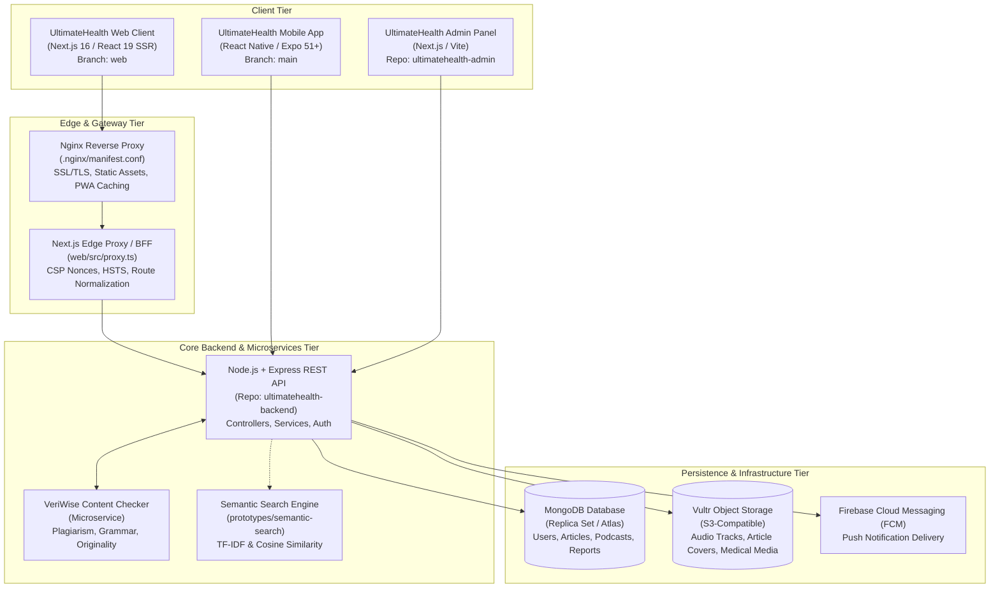
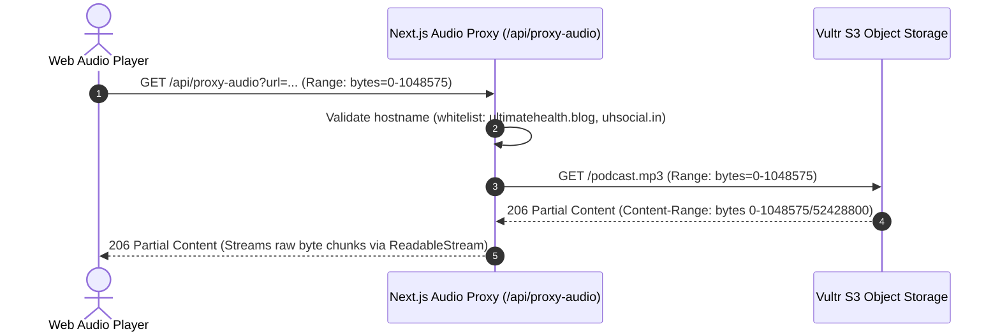

# UltimateHealth — End-to-End System Architecture Deep Dive

> **Architectural Blueprint & Reality Check**: This document formalizes the actual architecture of the UltimateHealth platform, mapping out the multi-repository topology, network boundaries, data pipelines, and infrastructure layers.

---

## 1. High-Level Multi-Repository Topology

UltimateHealth is partitioned into specialized services across repositories and branches to decouple mobile, web, backend API, and content auditing concerns:



---

## 2. Component Breakdown & Actual Implementations

### A. Web Application & Backend-For-Frontend (BFF)
- **Location**: `web/` (Branch: `web`)
- **Technology**: Next.js 16.2.6, React 19.2.4, TypeScript 5, Tailwind CSS v4.
- **Role**: Server-Side Rendered (SSR) web portal and API proxy.
- **Key Files**:
  - `web/src/proxy.ts`: Custom Next.js edge middleware. Enforces strict Content Security Policy (CSP) with dynamic per-request nonces, prevents open redirects, normalizes localized URL paths (`/web/en/...`), and attaches security headers (HSTS, COOP, CORP, Permissions-Policy).
  - `web/src/app/api/proxy-audio/route.ts`: Streaming audio reverse proxy with HTTP 206 Partial Content and Range headers to stream podcasts without CORS/CORP issues.
  - `web/src/app/api/proxy-image/route.ts`: Media proxy with fallback mechanisms.
  - `web/src/lib/auth/auth-service.ts`: Centralized web authentication bridge. Passes `x-client-type: web` to inform backend auth routing.
  - `web/Dockerfile`: Production multi-stage Docker build utilizing `node:22-alpine`, building Next.js in `standalone` output mode to reduce container image size.

### B. Core REST Backend API
- **Location**: Repository `SB2318/ultimatehealth-backend` (with reference implementations in `main:controllers/v2/usersController.js` and `main:bACKEND_SETUP.md`).
- **Technology**: Node.js, Express.js (v4.x), Mongoose ODM, MongoDB.
- **Role**: Authoritative data management, business logic, role-based access control, content workflow state machine.
- **Key Architectures**:
  - **Three-Token JWT Authentication**:
    - *Access Token* (15-minute lifespan): Short-lived bearer token for stateless API requests.
    - *Refresh Token* (7-day lifespan): Stored securely to rotate access tokens without forcing re-login.
    - *Verification Token* (1-hour lifespan): Cryptographically signed token for email activation and password resets.
  - **Password Security**: Salted Bcrypt hashing (`bcrypt.genSalt(10)`).
  - **OTP Security**: Time-based one-time password verification bound to user email before granting password mutation rights.

### C. Mobile Client
- **Location**: `frontend/` (Branch: `main`)
- **Technology**: React Native, Expo, Tamagui (Universal Design System), Redux Toolkit, Sentry error telemetry.
- **Role**: Cross-platform Android and iOS application for articles, podcast playback, and offline health wellness tracking.
- **Key Implementations**:
  - Offline sync slice (`frontend/src/store/offlineSlice.ts`).
  - Network state observation (`frontend/src/store/NetworkSlice.ts`).
  - Native release signing (`frontend/android/app/@uth-user-2025__UltimateHealth.jks`).

### D. Infrastructure & Web Server
- **Location**: `.nginx/`, root `docker-compose.yml`, root `Dockerfile`.
- **Technology**: Nginx, Docker, Linux (Alpine/Debian).
- **Configurations**:
  - `.nginx/manifest.conf`: Reverse proxy rules for PWA manifest caching (`Cache-Control: public, max-age=604800, immutable`), strict MIME-types (`application/manifest+json`), CORS headers for cross-origin PWA requests.
  - `docker-compose.yml`: Container orchestration exposing service port 5000 with environment propagation.

---

## 3. Critical Data Flows

### A. Authentication & Password Reset Flow
```mermaid
sequenceDiagram
    autonumber
    actor User as Client (Web/Mobile)
    participant Proxy as Next.js BFF / Route Handler
    participant Backend as Express Backend API
    participant DB as MongoDB

    User->>Proxy: POST /api/user/forgot-password { email }
    Proxy->>Backend: Forward request with x-client-type header
    Backend->>DB: Check User exists & generate 6-digit OTP
    Backend-->>User: OTP dispatched via Email (200 OK)
    
    User->>Proxy: POST /api/user/verify-otp-forgot-password { email, otp, newPassword }
    Proxy->>Backend: Forward validation request
    Backend->>Backend: verifyOtp(email, otp)
    alt OTP Invalid or Expired
        Backend-->>User: 400 Bad Request ("Invalid or expired OTP")
    else OTP Valid
        Backend->>Backend: bcrypt.genSalt(10) -> bcrypt.hash(newPassword)
        Backend->>DB: User.findOne({ email })
        Backend->>DB: user.password = hash; clear OTP fields; user.save()
        Backend-->>User: 200 OK ("Password reset successfully")
    end
```

### B. Audio Streaming Pipeline (Range Requests)


---

## 4. Key Engineering Trade-offs & Current Technical Debt

1. **Proxy SSRF Surface in `/api/proxy-image`**:
   - *Current State*: `web/src/app/api/proxy-image/route.ts` takes an arbitrary `url` query parameter and executes a `fetch(url)` without hostname whitelist validation (unlike `proxy-audio`).
   - *Risk*: Server-Side Request Forgery (SSRF) allowing attackers to probe internal cloud metadata endpoints (e.g. `169.254.169.254`) or intranet services.
   - *Resolution*: Apply strict domain whitelisting and IP address validation.

2. **Decoupled Backend Repositories vs Monorepo**:
   - *Current State*: Mobile and Web frontend live in branches of `UltimateHealth`, while the Express backend lives in `ultimatehealth-backend`.
   - *Trade-off*: Simplifies individual project size and contributor access during open-source hackathons (GSSoC), but risks API contract drift between frontend clients and backend models.

3. **In-Memory vs Distributed Caching**:
   - *Current State*: HTTP headers and edge proxy headers manage caching. No shared Redis instance is currently connected in local development.
   - *Implication*: Rate limiting and session storage cannot easily be shared horizontally across multiple Node.js server instances without Redis.
