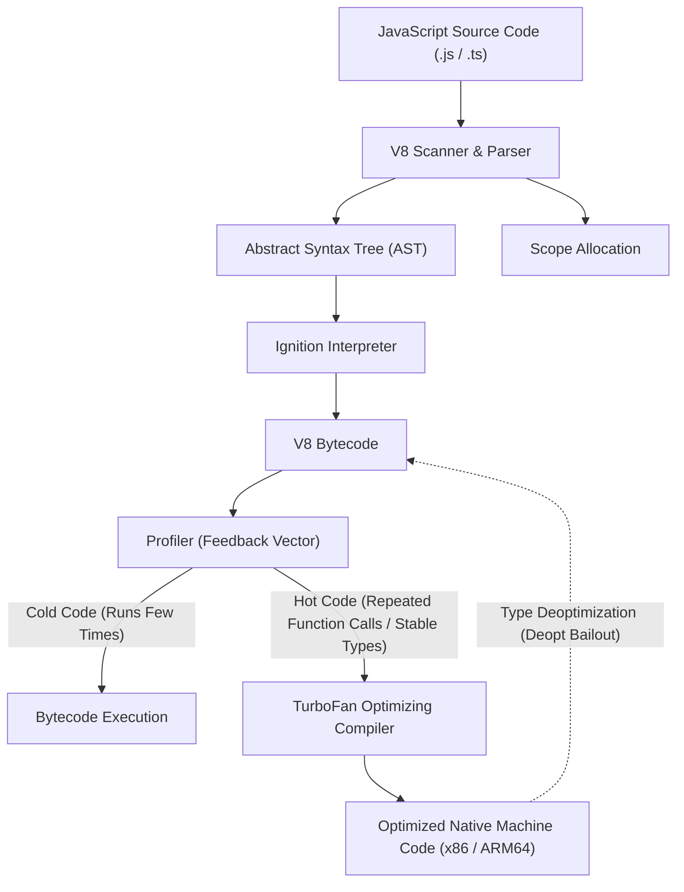
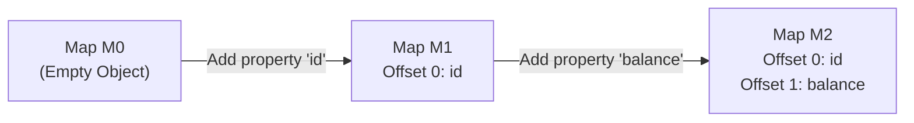
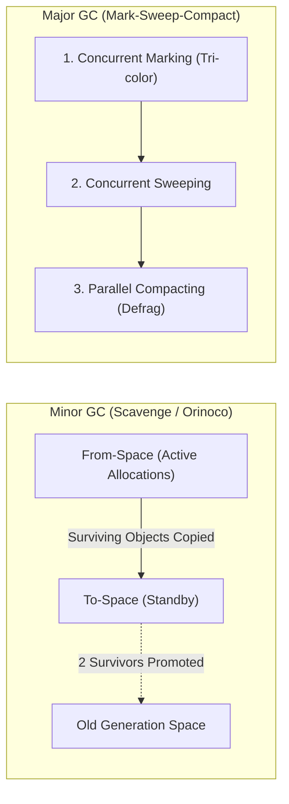

# Module 01: Deep Foundations — Computer Architecture, V8 Engine & JavaScript Internals

> **Foundational Engineering Doctrine**: Before understanding Node.js, Express, or backend APIs, an engineer must understand what happens physically at the silicone, kernel, and language runtime levels when code executes.

---

## 1. What Happens When a Program Executes?

### From Transistors to Assembly
A computer’s Central Processing Unit (CPU) does not understand JavaScript, Python, or even C. The CPU is a state machine consisting of:
- **Registers**: Ultra-fast storage locations on the CPU die (e.g., RAX, RBX, RIP on x86-64).
- **ALU (Arithmetic Logic Unit)**: Executes arithmetic and logical bit manipulations.
- **Control Unit**: Fetches instructions from memory, decodes them, and coordinates data movement.
- **Caches (L1, L2, L3)**: High-speed SRAM minimizing the high latency of fetching from main memory (DRAM).

When a program executes on an operating system:
1. **ELF / Mach-O / PE Binary Loading**: The OS kernel's loader reads the executable file from disk into RAM.
2. **Virtual Memory Mapping**: The OS creates a private virtual address space for the process (typically 48-bit address space on modern x86_64 architectures), backed by the CPU's Memory Management Unit (MMU) through page tables.
3. **Instruction Cycle (Fetch-Decode-Execute)**:
   - The Instruction Pointer (Program Counter `RIP`) holds the virtual memory address of the next machine instruction.
   - The CPU fetches the byte sequence from L1 instruction cache or RAM.
   - The instruction decoder translates machine opcodes into micro-operations.
   - The ALU or execution units fire, modifying registers, memory, or flags.

---

## 2. The Nature of JavaScript: Interpreted, Compiled, or JIT?

JavaScript is neither a purely interpreted language (like old-school shell scripts) nor an Ahead-Of-Time (AOT) compiled language (like C or Go). Modern JavaScript engines, specifically **Google V8** (which powers Chrome and Node.js), employ a **Multi-Tier Just-In-Time (JIT) Compiler with Adaptive Optimization**.



### The V8 Pipeline: Step-by-Step

1. **Scanner & Lexical Analysis**: Converts the UTF-16 stream into tokens (e.g., `const`, `identifier`, `assignment`, `literal`).
2. **Parser & AST Generation**: Constructs an Abstract Syntax Tree (AST) representing syntactic hierarchy, catching early syntax errors.
3. **Ignition (Register-based Bytecode Interpreter)**:
   - Emits compact V8 bytecode.
   - Why not compile directly to machine code? Native machine code consumes 10x–20x more RAM than bytecode. For massive web apps or microservices, direct compilation would cause massive memory bloat before code even runs.
4. **Feedback Vectors & Profiling**:
   - As Ignition executes bytecode, it records runtime type feedback in "Feedback Vectors".
   - It tracks questions such as: *Are the arguments passed to this function always integers? Does this object shape always have the same keys in the same order?*
5. **TurboFan (Optimizing Compiler)**:
   - When a function becomes "hot" (called thousands of times), TurboFan takes the bytecode and feedback vectors to generate blistering-fast, architecture-specific machine code.
   - It performs loop unrolling, dead code elimination, constant folding, and function inlining.
6. **Deoptimization Bailout**:
   - If an assumption fails (e.g., TurboFan assumed `calculateTax(price)` always receives an integer, but suddenly code passes `{ value: 100 }`), TurboFan aborts the optimized machine code, triggers a deoptimization (deopt) bailout, and falls back to Ignition's bytecode.

---

## 3. V8 Engine Memory Architecture: Call Stack vs. Heap

In Node.js and V8, process memory is divided into distinct structural regions:

```
+-------------------------------------------------------------+
|                     V8 Process Memory                       |
+-------------------------------------------------------------+
|  +--------------------+   +-------------------------------+  |
|  |     Call Stack     |   |          V8 Heap              |  |
|  |                    |   |                               |  |
|  | [ Stack Frame 2 ]  |   |  +-------------------------+  |  |
|  | [ Stack Frame 1 ]  |   |  |     New Space (Young)   |  |  |
|  | [ Global Frame  ]  |   |  |   [From] -> [To] (Semi) |  |  |
|  |                    |   |  +-------------------------+  |  |
|  | Primitive values,  |   |  |     Old Pointer Space   |  |  |
|  | Pointers to Heap,  |   |  |     Old Data Space      |  |  |
|  | Local variable refs|   |  +-------------------------+  |  |
|  +--------------------+   |  |     Large Object Space  |  |  |
|                           |  |     Code Space (JIT)    |  |  |
|                           |  |     Map Space (Shapes)  |  |  |
|                           |  +-------------------------+  |  |
+---------------------------+-------------------------------+--+
```

### The Call Stack
- **Structure**: Contiguous block of memory governed by the LIFO (Last-In, First-Out) principle.
- **Contents**: Stores primitive values (Booleans, Numbers within specific ranges, `null`, `undefined`, Symbols) and **Memory References (Pointers)** pointing to addresses on the Heap.
- **Stack Frame**: Every time a function is invoked, the CPU pushes a stack frame containing:
  1. Return address (where to resume execution when the function returns).
  2. Function arguments.
  3. Local variables.
- **Stack Overflow**: The stack has a fixed, strict size limit (typically 1MB to 8MB depending on architecture). If recursive calls exceed this boundary, V8 throws `RangeError: Maximum call stack size exceeded`.

### The Heap
- **Structure**: An unstructured, dynamically managed memory pool used for objects, closures, arrays, and complex data structures whose size is unknown at compile-time or changes dynamically.
- **Sub-spaces**:
  1. **New Space (Nursery / Young Generation)**: A small contiguous region (1MB–64MB) where almost all new allocations land. Divided into two equal semi-spaces: **From Space** and **To Space**.
  2. **Old Pointer Space**: Contains surviving objects that contain references to other objects.
  3. **Old Data Space**: Contains raw byte payloads (strings, raw numbers, boxed values).
  4. **Large Object Space**: Objects exceeding the allocation capacity of other spaces (allocated via `mmap`). They bypass New Space entirely and are never moved by garbage collection.
  5. **Map / Cell Space**: Contains Shapes/Hidden Classes of objects.

---

## 4. V8 Hidden Classes (Maps) and Inline Caching (IC)

One of the greatest performance breakthroughs in V8 is how it solves JavaScript’s dynamic object nature.

### Why Dynamic Languages Are Slow by Default
In C++ or Java:
```cpp
struct User {
    int id;       // Offset: 0 bytes
    double balance; // Offset: 8 bytes
};
```
The compiler knows exact memory offsets at compile-time. Fetching `user.balance` compiles into a single instruction: `MOVQ 8(%rax), %rbx`.

In naive JavaScript, an object is a dynamic dictionary:
```javascript
const user = {};
user.id = 1;
user.balance = 250.50;
```
Looking up `user.balance` would require a hash table lookup: computing a hash, searching a bucket, handling collisions—thousands of times slower than an offset read.

### The V8 Solution: Hidden Classes (Shapes/Maps)
V8 creates internal immutable descriptors called **Hidden Classes (Maps)** behind the scenes.

1. When `const user = {}` executes, V8 assigns it Map `M0`.
2. When `user.id = 1` is added, V8 creates a transition: `M0 -> M1 (offset 0: id)`.
3. When `user.balance = 250.50` is added, V8 creates a transition: `M1 -> M2 (offset 1: balance)`.



### The Pitfall: Shape Polymorphism & Inline Cache Thrashing
If two objects are instantiated with properties added in different orders:
```javascript
// Object A
const objA = {};
objA.x = 10;
objA.y = 20; // Resulting Map: M_xy

// Object B
const objB = {};
objB.y = 20;
objB.x = 10; // Resulting Map: M_yx (DIFFERENT MAP!)
```
When a function reads `point.x`:
- **Monomorphic IC** (Fastest): Always sees `M_xy`. TurboFan compiles the lookup into direct offset access `[base_pointer + 0]`.
- **Polymorphic IC**: Sees 2 to 4 different maps. Uses a branch table.
- **Megamorphic IC** (Slowest): Sees > 4 different maps. TurboFan bails out and falls back to a generic hash table lookup.

---

## 5. Garbage Collection: Scavenger (Minor GC) vs. Mark-Sweep-Compact (Major GC)

V8 implements the **Weak Generational Hypothesis**: *Most objects die young.*



### 1. Minor GC (Cheney's Copying Algorithm / Scavenger)
- Operates strictly on **New Space**.
- Allocations occur in **From-Space**. When From-Space fills up, Minor GC triggers.
- It traverses active root pointers. Live objects are **copied** into **To-Space**. Dead objects are simply ignored (erased en masse).
- The roles of From-Space and To-Space are swapped.
- If an object survives two consecutive Scavenge rounds, it is **promoted (tenured)** into the **Old Space**.
- **Performance**: Extremely fast (1–5ms) because it only touches live objects, which in healthy code is a tiny fraction of total allocations.

### 2. Major GC (Full Mark-Sweep-Compact)
When the Old Space reaches its dynamically adjusted threshold, Major GC initiates:
1. **Marking (Tri-color Marking)**:
   - *White*: Unvisited objects (candidates for deletion).
   - *Grey*: Visited objects whose children haven't been inspected yet.
   - *Black*: Live objects whose reachable children have all been inspected.
   - V8 uses **Concurrent Marking** on background threads while JavaScript continues executing on the main thread, minimizing "Stop-The-World" pauses.
2. **Sweeping**:
   - Background threads iterate through free-list memory blocks, reclaiming memory occupied by dead (white) objects.
3. **Compacting**:
   - Memory becomes fragmented over time. V8 moves live objects together to defragment the heap, updating all referencing pointers.

---

## 6. Real UltimateHealth Connection

Look at our actual implementation in `c:\UltimateHealth\web\Dockerfile`:

```dockerfile
# Line 8 of Dockerfile:
ENV NODE_OPTIONS="--max-old-space-size=2048"
ENV NEXT_BUILD_WORKERS=1
ENV NEXT_PRIVATE_WORKERS=1
```

### Why does this exist from first principles?
1. By default on 64-bit systems, Node.js caps the V8 Old Space to approximately 1.4 GB to 1.7 GB (to guarantee predictable GC pause times).
2. During `pnpm run build`, Next.js compiles dozens of TypeScript routes, bundles server components, parses CSS, and executes AST transforms.
3. If memory demands exceed the default Old Space limit, V8's Major GC triggers frantic, back-to-back Mark-Sweep-Compact cycles attempting to reclaim memory.
4. When Old Space remains above 95% saturation despite GC, V8 halts execution with:
   `FATAL ERROR: Ineffective mark-compacts near heap limit Allocation failed - JavaScript heap out of memory`.
5. Setting `NODE_OPTIONS="--max-old-space-size=2048"` explicitly instructs V8 to expand its Virtual Memory heap boundary to 2,048 MB before terminating, preventing OOM build crashes on containerized CI runners!
